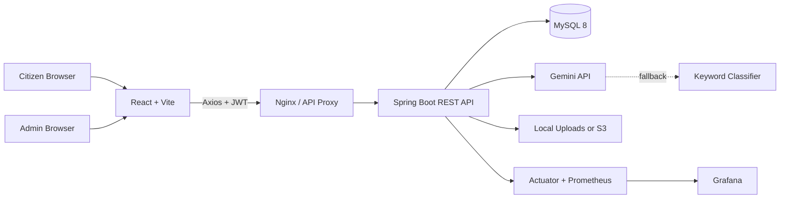
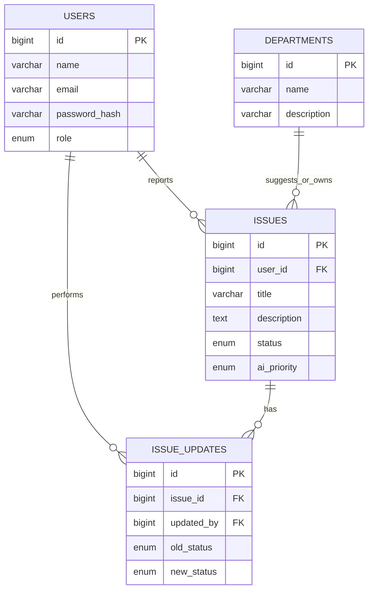

# AI Smart City Issue Management System

Complete monorepo for citizen issue reporting, AI classification, department assignment, status workflows, and resolution tracking.

## Team
- Shashank Chauhan: Backend & AI Developer
- Rishabh Singh: Frontend Developer
- Rishabh Gautam: Database & Testing Developer
- Samar Dixit: DevOps & Cloud Engineer

## Architecture


## ER Diagram


## Tech stack
React/Vite/Tailwind, Spring Boot 3/Java 17, Spring Security/JWT, JPA, MySQL 8, Gemini REST, Docker Compose, GitHub Actions, AWS EC2/RDS/S3/IAM/CloudWatch.

## Run locally
1. Copy `.env.example` to `.env` and adjust values.
2. Run `docker compose up --build`.
3. Open http://localhost:3000.
4. Swagger: http://localhost:8080/swagger-ui.html
5. Backend health: http://localhost:8080/actuator/health

## Authentication settings

Set these values in `.env`:

```env
ADMIN_REGISTRATION_CODE=choose-a-private-admin-code
SMTP_HOST=smtp.example.com
SMTP_PORT=587
SMTP_USERNAME=your-smtp-user
SMTP_PASSWORD=your-smtp-password
SMTP_FROM=no-reply@your-domain.example
```

Registration OTP and login OTP are required. An exact `ADMIN_REGISTRATION_CODE` match creates an `ADMIN`; an incorrect or blank code creates a `CITIZEN`.

Without SMTP settings, local API responses include `developmentOtp`. Configure SMTP for production email delivery.

## Manual setup
```powershell
cd backend
mvn test
mvn spring-boot:run
```
```powershell
cd frontend
npm install
npm run dev
```
Run MySQL 8 locally and set `SPRING_DATASOURCE_URL`, `SPRING_DATASOURCE_USERNAME`, and `SPRING_DATASOURCE_PASSWORD`.

## Default credentials
- Admin: `admin@city.com` / `Admin@123`
- Citizen: `citizen@city.com` / `Citizen@123`

## API endpoints
- `POST /api/auth/register`
- `POST /api/auth/login`
- `POST /api/issues` - multipart citizen issue
- `GET /api/issues/my`
- `GET /api/issues/{id}`
- `GET /api/admin/issues`
- `PUT /api/admin/issues/{id}/verify`
- `PUT /api/admin/issues/{id}/assign`
- `PUT /api/admin/issues/{id}/status`
- `GET /api/admin/stats`
- `GET /api/departments`

## Monitoring
Run `docker compose -f docker-compose.yml -f devops/monitoring/docker-compose.monitoring.yml up -d --build`
- Prometheus: http://localhost:9090
- Grafana: http://localhost:3001 (`admin` / `admin`)

## Screenshots
Add application screenshots here:
- Landing
- Citizen dashboard
- AI issue submission
- Issue timeline
- Admin dashboard
- Admin issue table

## GitHub Actions secrets
- `DOCKERHUB_USERNAME`, `DOCKERHUB_TOKEN`
- `EC2_HOST`, `EC2_USER`, `EC2_SSH_KEY`

For AWS setup, see [devops/aws/AWS_DEPLOYMENT.md](devops/aws/AWS_DEPLOYMENT.md).
